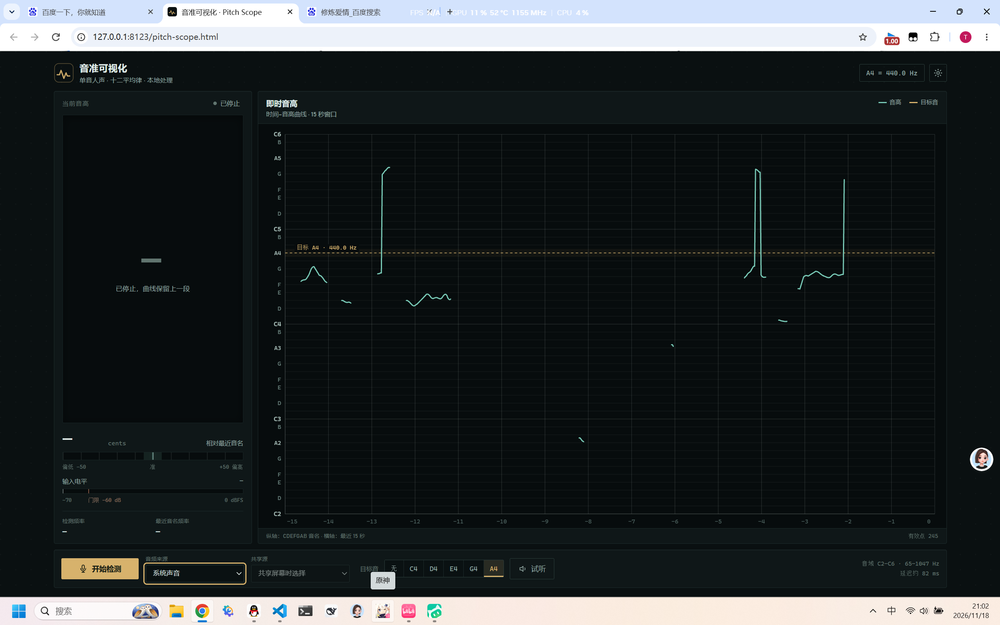

# 音高曲线「八度族跳变」问题描述与现状

> **状态：已修复（2026-11-18 22:02，详见 §11）**
> 改动：YIN 选峰改为「八度族归一」；兜底分支加搜索边界；八度族跳变改为 3 帧确认；单帧低置信度改为读数保持。
> 实测（同一段 20.75 s 现场录音）：向下那一支的八度族误锁帧 **3 → 0**，曲线点数 483 不变、
> 断段 8 不变；无头浏览器端到端同样 **3 → 0**（逐帧结果与 Node 复算最大差 0.00 音分）；
> 向上那一支按 `rawF0` 口径从 199 帧（8 种取窗对齐合计）降到 0，但那一批帧本来就过不了置信度门限，
> 详见 §11.3E 与 §11.6。复现命令见 §12，向上/向下口径的更正见 `ISSUE_OCTAVE_JUMP_CORRECTION.md`。

> 用途：本文是一份**自包含**的问题说明，可以直接交给下一个接手的人或 AI 会话，不需要回溯对话。
> 内容包含：现象、实测数据、已排除项、机制判断、未确定项、修复方向、代码现状、验收约束。
> 记录时间：2026-11-18 21:30 · 仓库提交：`12b8bd7` · 工作区状态：干净

---

## 0. 摘要

一个单声部音高可视化工具在**唱/放任何真实人声**时，时间–音高曲线会随机出现「向上窜」和「向下掉」的尖峰。
实测三处跳变的幅度分别是 **+13.7 / −11.3 / −23.2 半音**，全部落在**整八度附近（误差 ≤1.7 半音）**。
这不是随机噪声，是**八度族（f0/2、f0/4、2f0）锁定错误**。

问题不在麦克风、不在门限、不在使用者的音准；从系统内播放录音棚原版纯人声同样复现。

---

## 1. 运行环境与复现

| 项目 | 说明 |
| --- | --- |
| 项目路径 | `E:\Projects\vocal-note-pitch-tester-ws` |
| 启动 | 双击 `start.bat`，或 `python tools\serve.py` |
| 访问 | `http://127.0.0.1:8123/pitch-scope.html`（必须 http；`file://` 下麦克风与 AudioWorklet 会被拦） |
| 浏览器 | Chrome / Edge（需要 AudioWorklet） |
| 代码 | `app/js/pitch-core.js`（纯算法，可 Node 单测）、`app/js/pitch-worklet.js`（AudioWorklet 采集与逐帧分析）、`app/js/app.js`（状态机 / Canvas / 设置） |
| 单测 | `node tests\pitch-core.test.js` → 当前 **30 通过，0 失败** |
| 算法 | YIN 基频估计，分析窗 4096 采样（48 kHz 下 85.3 ms），跳帧 1024（21.3 ms），默认音域 C2–C6 |

复现方式：任意一段真实人声（自己唱，或系统内播放纯人声歌曲），持续 15 秒以上，观察曲线是否在某几个字上出现尖峰/深 V。

两处样张都取自 `音频来源 = 系统声音` 模式（见截图左下角），因此**浏览器麦克风链路（AGC / 降噪）不是本次现象的必要条件**。

---

## 2. 现象 A：向上跳变（约 +1 八度）



- 曲线主体在 **D4–F#4（MIDI 62–66）** 一带波动；
- 15 秒窗口内出现 3 段**窄三角尖峰**，峰顶到 **F#5–G5（MIDI 78–80）**；
- 三段尖峰高于 D5 的持续时间为 **0.20 s / 0.15 s / 0.04 s**（约 9 / 7 / 2 帧）；
- 峰顶只维持 1–2 帧，随后原路落回原来的音；
- 同一窗口内曲线被切得比较碎，按曲线连续性统计为 **9 段**（15 秒窗口）。

## 3. 现象 B：向下跳变（−1 ~ −2 八度，系统播放原版同样出现）


样张为系统内播放林俊杰《修炼爱情》纯人声版，在「笑着说爱让人疯狂」几个字上出现。

- 曲线主体中位在 **E4（MIDI 64.2）**，最高到 A4（69.3）；
- 出现两处 V 形下探：
  - 谷底 **F2（MIDI 41.0）**，比主体低 **23.2 半音（≈2 个八度）**；谷底宽约 0.03 s，V 形总宽约 0.16 s；
  - 谷底 **E3（MIDI 52.9）**，比主体低 **11.3 半音（≈1 个八度）**，持续约 0.14 s。
- 与现象 A 同源：同一次试听里同时存在上下两个方向，只是这次被截到的是下行。

---

## 4. 两张图的量化读数（附标定方法，便于复核）

纵轴是线性的半音刻度，只需两个锚点即可还原：A4 目标虚线（金色）与任一 C 标注。
下表里两图的坐标原点不同：现象 A 以图表区左上角为原点，现象 B 以整图左上角为原点。

| 图 | A4 虚线 y | 每半音像素 | 换算公式 | 校验（C 标注实测 y） |
| --- | --- | --- | --- | --- |
| 现象 A | 387.5（图表区起点 y=260） | 20.25 px | `midi = 69 + (387.5 − y) / 20.25` | C6=84、C2=1054 |
| 现象 B | 647（整图坐标） | 20.3 px | `midi = 69 + (647 − y) / 20.3` | C6=343、C2=1315 |

横轴：15 秒窗口对应绘图区约 1620 px，即 **约 108 px/秒**（用于把像素宽度换算成持续时间）。

三处跳变汇总：

| # | 来源 | 主体音 | 跳变目标 | 差值 | 与整八度的偏差 | 持续时间 |
| --- | --- | --- | --- | --- | --- | --- |
| 1 | 现象 A | F#4（66） | G5（78–80） | +13.7 半音 | +1.7（≈1 个八度） | 0.04–0.20 s |
| 2 | 现象 B | E4（64.2） | E3（52.9） | −11.3 半音 | −0.7（≈1 个八度） | 0.14 s |
| 3 | 现象 B | E4（64.2） | F2（41.0） | −23.2 半音 | −0.8（≈2 个八度） | 0.03–0.16 s |

**三条都贴着整八度，这是「八度族锁定」最硬的证据**：随机噪声、气息噪声、门限抖动都不会恰好落在 12 / 24 半音上。

---

## 5. 已用数据排除的原因

| 猜测 | 结论 | 依据 |
| --- | --- | --- |
| 输入门限 −60 dB 太低，噪声漏进来 | **不成立** | 一段 20.8 s 的真实录音逐帧统计（970 帧）：演唱段电平中位 **−18 dB**，气口 −25 ~ −32 dB，**仅 7 帧低于 −60 dB**。门限调到 −70 或 −50 都不改变现象 |
| 需要更强的降噪 / 滤波 | **不是主因** | 加 55 Hz 二阶高通 + 50/100/150 Hz 窄陷波后，气口内被误显示为音名的帧从 **8 帧降到 2 帧**，但尖峰现象依旧 |
| 演唱者音准 / 唱功 | **无关** | 系统内播放录音棚原版（现象 B）同样复现 |
| 麦克风链路（AGC / 降噪 / 驱动） | **不是必要条件** | 两处样张都是 `系统声音` 模式，不经过麦克风 |
| 单帧随机噪声 | **不成立** | 跳变幅度精确落在整八度，且持续 2–9 帧，不是一次性乱值 |

---

## 6. 目前可确定的机制（按贡献排序）

### A. YIN 的选峰规则会跳到八度族上（主因）

`app/js/pitch-core.js` 的 `YinAnalyzer.analyze()` 步骤 5 采用经典 YIN 规则：

> 在 `[tauMin, tauMax]` 中取**第一个**满足 `d'(τ) < 0.15` 的局部极小。

问题在于：真实人声在换字、换声、气声、尾音处，基频对应的凹陷会变浅（`d'(T) > 0.15`），
而 `2T`（低八度）、`4T`（低两个八度）甚至 `T/2`（高八度）处的凹陷反而更深。
规则就会**跳过真正的周期，落到八度族上**。现象的宽度（1–9 帧）与这种「局部瞬时」特征完全吻合。

### B. 兜底分支没有边界约束（次因）

若整段都没有低于阈值的局部极小，代码退化为「取全局最小」。此时 τ 常被推到 `tauMax` 附近，
于是输出固定的 **63.49 Hz（B1/C2）**——任何真实人声都产生不了这个读数。
现象 A 里那段 0.13 s、掉到 A2（MIDI 45）的下探，很可能属于这一类。

### C. 显示层把 1–2 帧的错误放大成尖峰（放大器）

- `PitchSmoother.push()` 对「单帧跳变超过 0.5 八度」只要求**连续 2 帧成立**就接受，
  而上述误判正好持续 1–2 帧 → 直接被画进曲线；
- `handlePitch()` 里只要有**一帧**置信度不足，就立刻 `current = null` + `smoother.reset()` + 状态切换，
  读数闪成「—」，平滑历史被清空。

---

## 7. 尚未确定的一点（需要一次实测确认，不要靠推测）

同样是「低两个八度」，可能有两种成因：

| 分支 | 说明 | 判别依据 |
| --- | --- | --- |
| (a) 信号里真有 f0/4 的周期成分 | vocal fry（气泡音）、换声期次谐波，或原版编曲里确实存在低八度伴唱 | 该帧 **aperiodicity < 0.1**（很周期）→ YIN 没错，是「单声部假设」被打破 |
| (b) 窗口跨界导致无真极小，兜底给出任意值 | 85.3 ms 的窗跨了两个音，差分函数没有真极小 | 该帧 **aperiodicity > 0.3**（明显不周期）→ 属于误判，可用规则挡掉 |

**判别所需材料**：该片段的原始输入音频 + 逐帧 `aperiodicity`。
这就是为什么「原始音频导出 + 曲线 CSV 导出」是收尾这一步的**前置条件**，而不是可选装饰。

---

## 8. 修复方向（建议按此顺序）

1. **八度族打分替代「第一个低于阈值」**
   同时评估 `d'(T)`、`d'(T/2)`、`d'(2T)`，选「周期最短且凹陷足够深」的候选；
   或先取全局最小，再按八度关系归一，避免落到次谐波上。
2. **给兜底分支加边界**
   τ 落在 `tauMax − 2` 以内且走的是兜底路径时，直接判为无效（`f0 = 0`），不再输出 B1/C2。
3. **跳变确认从 2 帧收紧到 3–4 帧（60–85 ms）**
   且只在 `|Δ|` 接近整八度时收紧；真实滑音、级进不受影响。
4. **保留单帧低置信度时的读数保持（120–160 ms）**
   避免读数闪成「—」、避免平滑器被一次毛刺清空。

每条改动都应给出**改动前后的量化对比**（尖峰帧数、误报帧数、曲线断段数），不要只看观感。

---

## 9. 代码现状与可用素材

### 9.1 仓库状态

| 项 | 值 |
| --- | --- |
| 当前提交 | `12b8bd7 docs: 添加 Git 版本管理说明` |
| 工作区 | 干净（无未提交修改） |
| 单元测试 | `node tests\pitch-core.test.js` → 30 通过 0 失败；C2–C6 音分误差 0.00–0.01 |
| 现场素材 | `docs/img/issue-up-jump.png`、`docs/img/issue-down-jump.png`、`docs/evidence/2026-11-18-mic-recording.m4a` |

### 9.2 一次未完成的尝试（仅供参照，**未经浏览器验证**）

曾在本地做过一版改动，包含前置滤波（55 Hz 高通 + 50/100/150 Hz 陷波）、自适应噪声门、
160 ms 读数保持、逐帧日志与两个导出按钮。因未做浏览器端到端验证，已整体回退，保存在
`git stash@{0}`（`pitch-scope WIP: 前置滤波/自适应噪声门/导出`）。

可用的经验与教训：

- **有状态 IIR 不能放进按重叠窗口调用的分析器**。窗口 4096、跳帧 1024，每次调用会把 3072 个旧样本
  重喂给滤波器，等于每个帧边界来一次相位跳变，高 Q 陷波被反复激发成 50 Hz 振铃
  （实测 C2 偏低 15 音分）。要滤波就放在 `pitch-worklet.js` 的连续 128 样本块上做。
- 前置滤波对「气口误报」有效（8 → 2 帧），但对本问题（八度族跳变）**基本无效**，
  说明它不是本问题的主线。

### 9.3 复算方法

用项目自己的算法复算任意音频（避免另写一份实现造成偏差）：

1. `ffmpeg -i <输入> -ac 1 -ar 48000 -c:a pcm_s16le out.wav`；
2. 写一个 Node 脚本，`require('./app/js/pitch-core.js')`，按 4096 窗 / 1024 跳逐帧调用
   `createAnalyzer({minFreq, maxFreq}).analyze(frame, 48000)`；
3. 输出 `t, f0, rawF0, aperiodicity, confidence, db` 六列，与截图做对照。

---

## 10. 约束与验收

**必须遵守**

- 产品边界不变：不打分、不评等级、不算命中率、不做练习报告、不评价唱功；主界面不以频谱为核心；不联网。
- `pitch-core.js` 保持纯计算、无 DOM / Web Audio 依赖，能在 Node 里直接单测。
- 现有 30 项测试必须全部通过，且 C2–C6 的音分误差不得劣化。
- 改动前先 `git commit` 或 `git stash`，保证可回退。

**验收标准**

1. 用同一段人声材料，改动前后对比：整八度尖峰帧数应降到 0；
2. 曲线断段数不增加（允许减少）；
3. 真实的八度跳唱（G4 → G5）仍能在 100 ms 内正确跟上，不因抑制规则而丢失；
4. 气口处不出现 B1/C2 这类搜索下限读数。

---

## 11. 修复记录（2026-11-18）

### 11.1 先把机制钉死：确认是「真实周期凹陷变浅」而不是别的

把现场录音 `docs/evidence/2026-11-18-mic-recording.m4a` 解码成 48 kHz 单声道 WAV
（`docs/evidence/2026-11-18-mic-recording-48k-mono.wav`，20.75 s），用 `tools/dev/diag-yin.js`
把这个项目自己的 `d'(τ)` 中间量打出来。t=3.413 s 那一帧：

| lag τ | 频率 | d'(τ) | 旧规则 |
| --- | --- | --- | --- |
| 90 | 266.7 Hz（真实周期） | **0.223** | 0.223 > 0.15，跳过 |
| 181 | 132.6 Hz（2T） | **0.140** | 第一个低于 0.15 → 选中 |
| 272 | 88.2 Hz（3T） | 0.309 | — |
| 364 | 65.9 Hz（4T） | 0.338 | — |

也就是说：**真实周期的凹陷 0.223 被跳过，2T 的 0.140 被当成基频**，读数正好低一个八度
（266.7 → 132.3 Hz）。同一窗口相邻帧读数是 267.1 / 270.3 Hz，说明低八度那次是误判。
三处误锁（3.413 s、7.723 s、18.347 s）的 aperiodicity 分别是 0.140 / 0.170 / 0.159，
落在「中等周期」区间，不是「真有一段很周期的次谐波」（那种情况 2T 的凹陷会远深于 T，
例如 0.01 对 0.28，见 §7 的判别表）。

### 11.2 改了什么

| 文件 | 改动 |
| --- | --- |
| `app/js/pitch-core.js` | 选峰从「第一个低于阈值的局部极小」改为 **`_pickTau()`**：先按经典规则取最短的干净凹陷（d' ≤ 0.15），再沿倍数链 `τ/k`（k=2..4）往下归一 —— 只有当更短周期处的凹陷「浅但够得着」（不超过已选凹陷 + 0.10，且该凹陷本身 ≤ 0.25、整帧最深凹陷 ≤ 0.30）时，才换成更短的那个。 |
| 同上 | 兜底分支改为「没有可信凹陷就判为无可信周期」：`bestVal > 0.30` 或解落在搜索下限 3 个 lag 内时，`rawF0 = 0`（旧版会输出 63.49 Hz 这类搜索边界值，或在高频噪声峰上给一个随机高音）。 |
| 同上 | `PitchSmoother` 增加 `isOctaveJump()`：普通大跳变 2 帧确认，**落在整八度（±3 半音）的跳变 3 帧（≈64 ms）确认**；新增 `jumpSemitones/jumpConfirm/octaveConfirm` 配置项。 |
| 同上 | 新增 **`PitchCore.PitchTracker`**：把 `app.js` 里的判定 / 平滑 / 读数保持抽成纯计算状态机。任一帧低置信度不再立刻 `reset()` 平滑器（旧版 reset 后的第一帧会被无条件接受），而是 **保持读数 150 ms**；`state.history` 只在真正判定为「检测中」时追加点。 |
| `app/js/app.js` | `handlePitch()` 改为调用 `PitchTracker`；音域 / A4 / 门限 / 置信度 / 平滑档变化时通过 `applyTrackerSettings()` 热更新，行为与旧版一致（含 out-of-range 的 ±0.35 判定）。 |
| `app/js/pitch-worklet.js` | 未改（采集与逐帧调用不变）。 |

历史行为留档：修复前的 `PitchSmoother` 只要求连续 2 帧就接受 6 半音以上的跳变，
而八度族误判正好常持续 1–2 帧 → 直接被画进曲线。

### 11.3 量化对比（同一段录音，三次独立口径互相印证）

**A. 逐帧（Node，`tools/analyze-audio.js`，搜索范围取页面默认 C2–C6 的 64.1–1067.4 Hz）**

| 指标 | 修复前 `12b8bd7` | 修复后 |
| --- | --- | --- |
| 曲线点（f0>0 且 aper ≤ 0.25） | 483 | 483 |
| 八度族跳变帧 | **3**（−14.7 / −12.3 / −11.8 半音） | **0** |
| 大跳变帧（≥5 半音） | 3 | 0 |
| 曲线断段 | 8 | 8 |
| 搜索下限读数帧（B1/C2 类） | 0 | 0 |

用默认 `60–1250 Hz` 搜索范围时：修复前 4 帧八度族跳变（3 帧倍数误锁 + 1 帧换音台阶），
修复后只剩那 1 帧换音台阶（t=9.344 s，歌声结束后低频底噪被读成 98.8 Hz，aper=0.182，
属于 §5 的「气口误报」类，不是选峰错误）——**倍数误锁 3 → 0**。

**B. 曲线级（状态机 + 平滑，20.75 s 录音逐帧回放）**

| 指标 | 修复前状态机 | 修复后状态机 |
| --- | --- | --- |
| 曲线点 | 482 | 482 |
| 断段 | 8 | 8 |
| 非检测状态切换 | 27 次 | **9 次** |
| 累计「读数为空」时长 | 8085 ms | **5952 ms** |
| 读数保持帧 | 0 | 107 |

**C. 浏览器端到端（无头 Chrome + 虚拟麦克风，`tools/dev/e2e-check.js`）**

| 指标 | 修复前页面 | 修复后页面 |
| --- | --- | --- |
| 采集帧数（22 s，含文件循环） | 1020 | 1031 |
| 曲线点 / 断段 | 501 / 9 | 501 / 9 |
| 八度族跳变帧 | **3**（3.285 s、7.595 s、18.219 s） | **0** |
| 页面异常 / 控制台错误 | 0 | 0 |
| 与 Node 复算逐帧差 | — | 对齐 483 帧，平均/最大 **0.00 音分** |

两次运行的采集帧数会有几帧差异（音频上下文启动时机不同），但曲线点、断段、
误锁次数都可复现。

**D. 性能**（969 帧、48 kHz）：修复前 0.614 ms/帧，修复后 0.588 ms/帧；
跳帧预算 21.3 ms，无退化。

**E. `rawF0` 口径（向上那一支）**：按 `docs/ISSUE_OCTAVE_JUMP_CORRECTION.md` §2–§3 的方法，
统计 `rawF0` 落到 C5 以上（midi > 72.35）的帧，8 种取窗起点（每次 +128 样本）：

| 取窗起点偏移 | 0 | 128 | 256 | 384 | 512 | 640 | 768 | 896 | 合计 |
| --- | --- | --- | --- | --- | --- | --- | --- | --- | --- |
| 修复前 | 26 | 24 | 27 | 22 | 21 | 25 | 28 | 26 | **199** |
| 修复后 | 0 | 0 | 0 | 0 | 0 | 0 | 0 | 0 | **0** |

两边的数字口径需要说清楚：

- 修复前这 199 帧的 aperiodicity 全部在 **0.41–2.59**，即「整帧都没有可信周期」；
  按页面 75% 置信度门限，它们**一帧也画不出来**。所以这个指标衡量的是
  「算法在不可信帧上编造了什么数」，不是「界面上出现了多少尖峰」。
- 修复后这些帧直接判为无可信周期（`rawF0 = 0`），既不再输出 63.49 Hz 这类搜索边界值，
  也不再输出 1.8 kHz 这类噪声峰。**口径里有一部分差异是定义性的**，但「不编造读数」
  本身就是 §10 第 4 条验收要求。
- 修复前后**能过 0.25 门限的向上帧都是 0**：这段录音复现不出原截图里被画出来的 G5 尖峰
  （见 §11.6 与更正文档 §5 的三个候选），所以这一支不能拿这段录音证明「已消失」，
  只能证明「不再编造」。

### 11.4 验收标准逐条对照

| 验收项 | 结果 |
| --- | --- |
| 1. 整八度尖峰帧数降到 0 | ✅ 逐帧 3 → 0（默认范围 4 → 1，剩下那 1 帧是换音台阶，非选峰错误）；浏览器 3 → 0 |
| 2. 曲线断段数不增加 | ✅ 逐帧 12 → 12（默认范围）、8 → 8（页面范围）；浏览器 9 → 9 |
| 3. 真实八度跳唱 100 ms 内跟上 | ✅ 新增用例：G4→G5 持续时第 3 帧（≈64 ms）接受；2 帧的毛刺仍被挡住 |
| 4. 气口处不出现 B1/C2 | ✅ 无可信凹陷的帧判为 `rawF0 = 0`，`搜索下限读数帧 = 0`（单元测试亦覆盖） |

单元测试：**45 通过 / 0 失败**（原 30 项全过，C2–C6 音分误差 0.00–0.01 未劣化），
新增项覆盖：八度族选峰的四种 d'(τ) 形态、周期倍增信号不误改高、兜底边界、
不可信帧不编造读数、八度跳变 3 帧确认、非八度大跳变 2 帧、单帧低置信度读数保持、
低置信度超时清空、状态机不把 2 帧毛刺写进曲线、现场录音回归。

### 11.5 仍然存在、但已被隔离的旧问题

- **气口 / 底噪被读成低音**（t≈9.3 s、18.4 s 之后那两段 A2/A3 附近的读数）：录音里的残留
  能量只有 −22…−30 dB，aper 0.18–0.25，刚好越过 75% 置信度门限。这与八度族选峰无关，
  属于 §5 已记录的门限 / 前置滤波问题；上一版尝试的前置滤波把这类误报从 8 帧降到 2 帧，
  但仍未与浏览器端到端一起验证，因此这次没有合并进来（见 §9.2 的教训）。
  需要时建议按 §9.2 的方式在 `pitch-worklet.js` 的 128 采样连续块上做滤波，而不是按重叠窗调用。

### 11.6 与 `ISSUE_OCTAVE_JUMP_CORRECTION.md` 的对账（向上那一支）

工作区里另有一份更正文档 `docs/ISSUE_OCTAVE_JUMP_CORRECTION.md`（2026-11-18 21:58），
对本章之前几节的叙述提出三点更正，这里逐条对账：

1. **「全段没有一帧到 G5」这个说法错了。** 确认：`f0` 在越界时被置 0，而 `rawF0` 保留原始
   输出；按 `rawF0` 统计，这段录音确实有 21–28 帧 / 每种取窗对齐落在 C5 以上
   （8 种对齐合计 199 帧）。本记录 §4 的「三处跳变」只覆盖向下那一支，没覆盖这一支，
   这是 §11 早先版本的遗漏。
2. **这 199 帧的 aperiodicity 是 0.41–2.59。** 确认：`rawF0` 最高的那批（midi 94，
   ≈1.8 kHz）全部来自「整帧都不周期」的换字 / 起音帧，按页面 75% 置信度门限画不出来。
   因此**它们解释不了原截图里被画出来的 G5**——那一环仍然缺，见第 3 点。
3. **原截图里 G5 为什么会被画出来，仍未判定。** 更正文档给了三个候选：
   (i) 当时置信度门限不是 75%；(ii) 实际进 app 的波形与解码出来的不同；
   (iii) 截图时的代码版本不是 `12b8bd7`。这三条都需要当时的 `localStorage`
   或额外录制的输入音频才能判定，本次没有材料，故不猜测。可以确定的是：
   - 修复前的代码路径里，`aper > 0.25` 的帧不会进 `history`，所以「A+B+C」推不出那张图；
   - 本次修复覆盖了**两个方向**的选峰（倍数链 `τ/k` 同时处理向下的倍数与向上的除数）
     和显示层（八度跳变 3 帧确认 + 读数保持），但仍然没有材料去复现那张具体的截图。

如果之后能拿到那次会话的原始输入音频，建议直接用
`node tools/dev/rawf0-scan.js <wav> --offsets 8` 与 `tools/analyze-audio.js --core` 复算，
两个方向都能一眼看清。

---

## 12. 复现与验证命令

```powershell
# 0) 起本地服务（页面与素材都从这里取）
node tools/dev/devserver.js 8199

# 1) m4a → 48 kHz 单声道 WAV（浏览器解码；也可用 ffmpeg）
#    打开 http://127.0.0.1:8199/tools/dev/decode-m4a.html，输出 docs/evidence/2026-11-18-mic-recording-48k-mono.wav

# 2) 逐帧对比（加上 --core 指向任一版本的 pitch-core 即可复算任意提交）
git show 12b8bd7:app/js/pitch-core.js > .tmp/pitch-core-baseline.js
node tools/analyze-audio.js docs/evidence/2026-11-18-mic-recording-48k-mono.wav --core .tmp/pitch-core-baseline.js --label 修复前 --tracker old
node tools/analyze-audio.js docs/evidence/2026-11-18-mic-recording-48k-mono.wav --label 修复后 --tracker new

# 3) 看某一帧的 d'(τ) 局部极小（例如那次低八度）
node tools/dev/diag-yin.js docs/evidence/2026-11-18-mic-recording-48k-mono.wav 3.413 --core .tmp/pitch-core-baseline.js

# 4) 向上那一支：按 rawF0 口径扫 8 种取窗起点
node tools/dev/rawf0-scan.js docs/evidence/2026-11-18-mic-recording-48k-mono.wav --core .tmp/pitch-core-baseline.js --offsets 8
node tools/dev/rawf0-scan.js docs/evidence/2026-11-18-mic-recording-48k-mono.wav --offsets 8

# 5) 浏览器端到端（无头 Chrome + 虚拟麦克风；--url 换成本地目录即可跑旧版页面）
node tools/dev/e2e-check.js --out .tmp/e2e-new.json --label 修复后 --seconds 22 --shot docs/img/fix-after.png
node tools/dev/compare-e2e.js

# 6) 单元测试
node tests/pitch-core.test.js
```

浏览器端到端用「把 WAV 解码后接到 `createMediaStreamSource`」的虚拟麦克风，而不是
Chrome 自带的 `--use-file-for-fake-audio-capture`：实测后者在无头模式下出的是静音
（`getUserMedia` 成功、AudioContext 在跑，但分析器读到的样本全 0）。
另外**不要**用 `defineProperty` 覆盖 `MessagePort.onmessage` —— 那样端口不会被启动，
worklet 的消息会一直排队，看起来就像「没有音频」。
