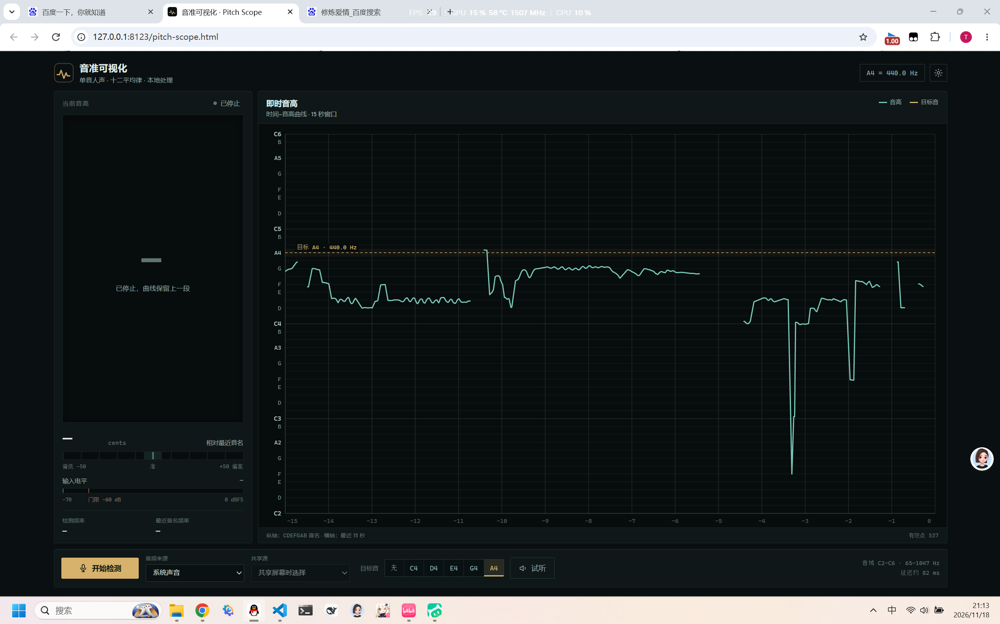

# 音高曲线「八度族跳变」问题描述与现状

> 用途：本文是一份**自包含**的问题说明，可以直接交给下一个接手的人或 AI 会话，不需要回溯对话。
> 内容包含：现象、实测数据、已排除项、机制判断、未确定项、修复方向、代码现状、验收约束。
> 记录时间：2026-11-18 21:30 · 仓库提交：`12b8bd7` · 工作区状态：干净

---

## 0. 摘要

一个单声部音高可视化工具在**唱/放任何真实人声**时，时间–音高曲线会随机出现「向上窜」和「向下掉」的尖峰。
实测三处跳变的幅度分别是 **+13.7 / −11.3 / −23.2 半音**，全部落在**整八度附近（误差 ≤1.7 半音）**。
这不是随机噪声，是**八度族（f0/2、f0/4、2f0）锁定错误**。

问题不在麦克风、不在门限、不在使用者的音准；从系统内播放录音棚原版纯人声同样复现。

---

## 1. 运行环境与复现

| 项目 | 说明 |
| --- | --- |
| 项目路径 | `E:\Projects\vocal-note-pitch-tester-ws` |
| 启动 | 双击 `start.bat`，或 `python tools\serve.py` |
| 访问 | `http://127.0.0.1:8123/pitch-scope.html`（必须 http；`file://` 下麦克风与 AudioWorklet 会被拦） |
| 浏览器 | Chrome / Edge（需要 AudioWorklet） |
| 代码 | `app/js/pitch-core.js`（纯算法，可 Node 单测）、`app/js/pitch-worklet.js`（AudioWorklet 采集与逐帧分析）、`app/js/app.js`（状态机 / Canvas / 设置） |
| 单测 | `node tests\pitch-core.test.js` → 当前 **30 通过，0 失败** |
| 算法 | YIN 基频估计，分析窗 4096 采样（48 kHz 下 85.3 ms），跳帧 1024（21.3 ms），默认音域 C2–C6 |

复现方式：任意一段真实人声（自己唱，或系统内播放纯人声歌曲），持续 15 秒以上，观察曲线是否在某几个字上出现尖峰/深 V。

两处样张都取自 `音频来源 = 系统声音` 模式（见截图左下角），因此**浏览器麦克风链路（AGC / 降噪）不是本次现象的必要条件**。

---

## 2. 现象 A：向上跳变（约 +1 八度）

- 曲线主体在 **D4–F#4（MIDI 62–66）** 一带波动；
- 15 秒窗口内出现 3 段**窄三角尖峰**，峰顶到 **F#5–G5（MIDI 78–80）**；
- 三段尖峰高于 D5 的持续时间为 **0.20 s / 0.15 s / 0.04 s**（约 9 / 7 / 2 帧）；
- 峰顶只维持 1–2 帧，随后原路落回原来的音；
- 同一窗口内曲线被切得比较碎，按曲线连续性统计为 **9 段**（15 秒窗口）。

## 3. 现象 B：向下跳变（−1 ~ −2 八度，系统播放原版同样出现）

样张为系统内播放林俊杰《修炼爱情》纯人声版，在「笑着说爱让人疯狂」几个字上出现。

- 曲线主体中位在 **E4（MIDI 64.2）**，最高到 A4（69.3）；
- 出现两处 V 形下探：
  - 谷底 **F2（MIDI 41.0）**，比主体低 **23.2 半音（≈2 个八度）**；谷底宽约 0.03 s，V 形总宽约 0.16 s；
  - 谷底 **E3（MIDI 52.9）**，比主体低 **11.3 半音（≈1 个八度）**，持续约 0.14 s。
- 与现象 A 同源：同一次试听里同时存在上下两个方向，只是这次被截到的是下行。

---

## 4. 两张图的量化读数（附标定方法，便于复核）

纵轴是线性的半音刻度，只需两个锚点即可还原：A4 目标虚线（金色）与任一 C 标注。
下表里两图的坐标原点不同：现象 A 以图表区左上角为原点，现象 B 以整图左上角为原点。

| 图 | A4 虚线 y | 每半音像素 | 换算公式 | 校验（C 标注实测 y） |
| --- | --- | --- | --- | --- |
| 现象 A | 387.5（图表区起点 y=260） | 20.25 px | `midi = 69 + (387.5 − y) / 20.25` | C6=84、C2=1054 |
| 现象 B | 647（整图坐标） | 20.3 px | `midi = 69 + (647 − y) / 20.3` | C6=343、C2=1315 |

横轴：15 秒窗口对应绘图区约 1620 px，即 **约 108 px/秒**（用于把像素宽度换算成持续时间）。

三处跳变汇总：

| # | 来源 | 主体音 | 跳变目标 | 差值 | 与整八度的偏差 | 持续时间 |
| --- | --- | --- | --- | --- | --- | --- |
| 1 | 现象 A | F#4（66） | G5（78–80） | +13.7 半音 | +1.7（≈1 个八度） | 0.04–0.20 s |
| 2 | 现象 B | E4（64.2） | E3（52.9） | −11.3 半音 | −0.7（≈1 个八度） | 0.14 s |
| 3 | 现象 B | E4（64.2） | F2（41.0） | −23.2 半音 | −0.8（≈2 个八度） | 0.03–0.16 s |

**三条都贴着整八度，这是「八度族锁定」最硬的证据**：随机噪声、气息噪声、门限抖动都不会恰好落在 12 / 24 半音上。

---

## 5. 已用数据排除的原因

| 猜测 | 结论 | 依据 |
| --- | --- | --- |
| 输入门限 −60 dB 太低，噪声漏进来 | **不成立** | 一段 20.8 s 的真实录音逐帧统计（970 帧）：演唱段电平中位 **−18 dB**，气口 −25 ~ −32 dB，**仅 7 帧低于 −60 dB**。门限调到 −70 或 −50 都不改变现象 |
| 需要更强的降噪 / 滤波 | **不是主因** | 加 55 Hz 二阶高通 + 50/100/150 Hz 窄陷波后，气口内被误显示为音名的帧从 **8 帧降到 2 帧**，但尖峰现象依旧 |
| 演唱者音准 / 唱功 | **无关** | 系统内播放录音棚原版（现象 B）同样复现 |
| 麦克风链路（AGC / 降噪 / 驱动） | **不是必要条件** | 两处样张都是 `系统声音` 模式，不经过麦克风 |
| 单帧随机噪声 | **不成立** | 跳变幅度精确落在整八度，且持续 2–9 帧，不是一次性乱值 |

---

## 6. 目前可确定的机制（按贡献排序）

### A. YIN 的选峰规则会跳到八度族上（主因）

`app/js/pitch-core.js` 的 `YinAnalyzer.analyze()` 步骤 5 采用经典 YIN 规则：

> 在 `[tauMin, tauMax]` 中取**第一个**满足 `d'(τ) < 0.15` 的局部极小。

问题在于：真实人声在换字、换声、气声、尾音处，基频对应的凹陷会变浅（`d'(T) > 0.15`），
而 `2T`（低八度）、`4T`（低两个八度）甚至 `T/2`（高八度）处的凹陷反而更深。
规则就会**跳过真正的周期，落到八度族上**。现象的宽度（1–9 帧）与这种「局部瞬时」特征完全吻合。

### B. 兜底分支没有边界约束（次因）

若整段都没有低于阈值的局部极小，代码退化为「取全局最小」。此时 τ 常被推到 `tauMax` 附近，
于是输出固定的 **63.49 Hz（B1/C2）**——任何真实人声都产生不了这个读数。
现象 A 里那段 0.13 s、掉到 A2（MIDI 45）的下探，很可能属于这一类。

### C. 显示层把 1–2 帧的错误放大成尖峰（放大器）

- `PitchSmoother.push()` 对「单帧跳变超过 0.5 八度」只要求**连续 2 帧成立**就接受，
  而上述误判正好持续 1–2 帧 → 直接被画进曲线；
- `handlePitch()` 里只要有**一帧**置信度不足，就立刻 `current = null` + `smoother.reset()` + 状态切换，
  读数闪成「—」，平滑历史被清空。

---

## 7. 尚未确定的一点（需要一次实测确认，不要靠推测）

同样是「低两个八度」，可能有两种成因：

| 分支 | 说明 | 判别依据 |
| --- | --- | --- |
| (a) 信号里真有 f0/4 的周期成分 | vocal fry（气泡音）、换声期次谐波，或原版编曲里确实存在低八度伴唱 | 该帧 **aperiodicity < 0.1**（很周期）→ YIN 没错，是「单声部假设」被打破 |
| (b) 窗口跨界导致无真极小，兜底给出任意值 | 85.3 ms 的窗跨了两个音，差分函数没有真极小 | 该帧 **aperiodicity > 0.3**（明显不周期）→ 属于误判，可用规则挡掉 |

**判别所需材料**：该片段的原始输入音频 + 逐帧 `aperiodicity`。
这就是为什么「原始音频导出 + 曲线 CSV 导出」是收尾这一步的**前置条件**，而不是可选装饰。

---

## 8. 修复方向（建议按此顺序）

1. **八度族打分替代「第一个低于阈值」**
   同时评估 `d'(T)`、`d'(T/2)`、`d'(2T)`，选「周期最短且凹陷足够深」的候选；
   或先取全局最小，再按八度关系归一，避免落到次谐波上。
2. **给兜底分支加边界**
   τ 落在 `tauMax − 2` 以内且走的是兜底路径时，直接判为无效（`f0 = 0`），不再输出 B1/C2。
3. **跳变确认从 2 帧收紧到 3–4 帧（60–85 ms）**
   且只在 `|Δ|` 接近整八度时收紧；真实滑音、级进不受影响。
4. **保留单帧低置信度时的读数保持（120–160 ms）**
   避免读数闪成「—」、避免平滑器被一次毛刺清空。

每条改动都应给出**改动前后的量化对比**（尖峰帧数、误报帧数、曲线断段数），不要只看观感。

---

## 9. 代码现状与可用素材

### 9.1 仓库状态

| 项 | 值 |
| --- | --- |
| 当前提交 | `12b8bd7 docs: 添加 Git 版本管理说明` |
| 工作区 | 干净（无未提交修改） |
| 单元测试 | `node tests\pitch-core.test.js` → 30 通过 0 失败；C2–C6 音分误差 0.00–0.01 |
| 现场素材 | `docs/img/issue-up-jump.png`、`docs/img/issue-down-jump.png`、`docs/evidence/2026-11-18-mic-recording.m4a` |

### 9.2 一次未完成的尝试（仅供参照，**未经浏览器验证**）

曾在本地做过一版改动，包含前置滤波（55 Hz 高通 + 50/100/150 Hz 陷波）、自适应噪声门、
160 ms 读数保持、逐帧日志与两个导出按钮。因未做浏览器端到端验证，已整体回退，保存在
`git stash@{0}`（`pitch-scope WIP: 前置滤波/自适应噪声门/导出`）。

可用的经验与教训：

- **有状态 IIR 不能放进按重叠窗口调用的分析器**。窗口 4096、跳帧 1024，每次调用会把 3072 个旧样本
  重喂给滤波器，等于每个帧边界来一次相位跳变，高 Q 陷波被反复激发成 50 Hz 振铃
  （实测 C2 偏低 15 音分）。要滤波就放在 `pitch-worklet.js` 的连续 128 样本块上做。
- 前置滤波对「气口误报」有效（8 → 2 帧），但对本问题（八度族跳变）**基本无效**，
  说明它不是本问题的主线。

### 9.3 复算方法

用项目自己的算法复算任意音频（避免另写一份实现造成偏差）：

1. `ffmpeg -i <输入> -ac 1 -ar 48000 -c:a pcm_s16le out.wav`；
2. 写一个 Node 脚本，`require('./app/js/pitch-core.js')`，按 4096 窗 / 1024 跳逐帧调用
   `createAnalyzer({minFreq, maxFreq}).analyze(frame, 48000)`；
3. 输出 `t, f0, rawF0, aperiodicity, confidence, db` 六列，与截图做对照。

---

## 10. 约束与验收

**必须遵守**

- 产品边界不变：不打分、不评等级、不算命中率、不做练习报告、不评价唱功；主界面不以频谱为核心；不联网。
- `pitch-core.js` 保持纯计算、无 DOM / Web Audio 依赖，能在 Node 里直接单测。
- 现有 30 项测试必须全部通过，且 C2–C6 的音分误差不得劣化。
- 改动前先 `git commit` 或 `git stash`，保证可回退。

**验收标准**

1. 用同一段人声材料，改动前后对比：整八度尖峰帧数应降到 0；
2. 曲线断段数不增加（允许减少）；
3. 真实的八度跳唱（G4 → G5）仍能在 100 ms 内正确跟上，不因抑制规则而丢失；
4. 气口处不出现 B1/C2 这类搜索下限读数。
